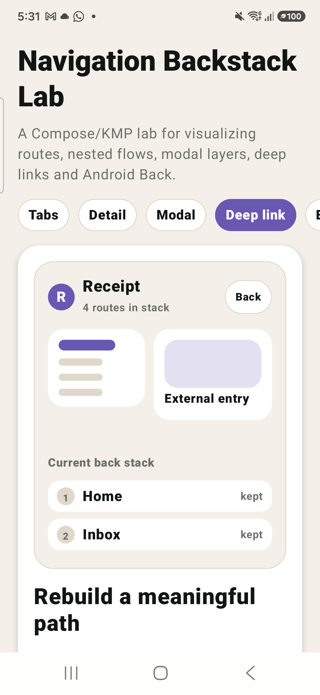

> **Ce lab a déménagé.** Il fait maintenant partie de [mobile-ui-labs](https://github.com/YANKAMKEVIN/mobile-ui-labs), qui réunit les 10 labs dans une seule app. Ce dépôt est archivé.

# Navigation Backstack Lab

Mini-projet Android/KMP pour explorer la navigation comme une experience produit, pas seulement comme une pile technique.

Le but n'est pas de livrer une app complete, mais de rendre visibles les decisions autour du back stack :

- historique separe par tab ;
- detail screen avec contexte preserve ;
- modal destination temporaire ;
- deep link avec chemin reconstruit ;
- comportement Back explicite.

## Pourquoi ce mini-projet ?

La navigation Android peut vite devenir invisible jusqu'au moment ou elle casse l'experience :

- que doit-il se passer quand l'utilisateur change de tab ?
- une sheet doit-elle entrer dans la pile ?
- un deep link doit-il ouvrir uniquement l'ecran cible ou reconstruire un chemin ?
- ou va le bouton Back apres un detail ?
- comment designers et devs peuvent-ils raisonner sur la meme pile ?

Le lab visualise les routes et la destination courante pour faciliter la discussion entre UX et implementation.

## Stack

- Kotlin Multiplatform
- Compose Multiplatform
- Material 3
- Android target pret a lancer

## Screenshots

<p align="center">
  
</p>

## Idee de post LinkedIn

> Le back stack est une partie de l'UX.
>
> Dans ce mini-projet Compose/KMP, je visualise plusieurs scenarios de navigation : tabs, detail screen, modal route, deep link et Android Back.
>
> Ce qui m'interesse : rendre la navigation assez visible pour que designers et devs puissent discuter du meme comportement.

## Run

```bash
./gradlew :composeApp:assembleDebug
```
